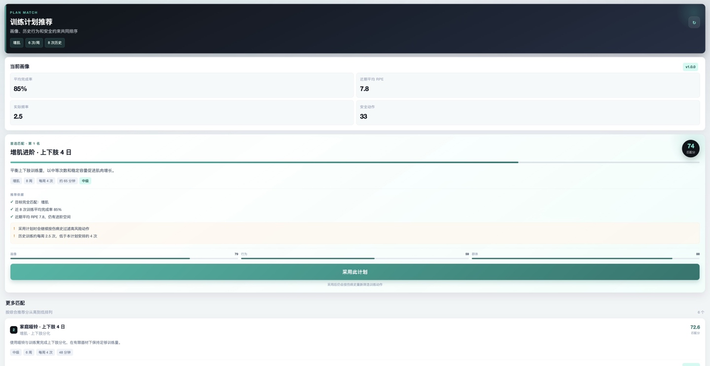
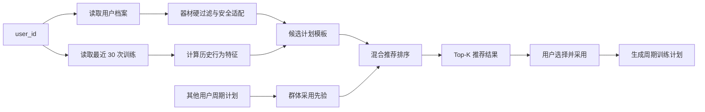

# 训练计划推荐模块

## 1. 功能简介

训练计划推荐模块用于根据用户的训练目标、训练水平、训练频率、可用器材、伤病史和历史训练表现，从系统支持的计划模板中生成个性化 Top-K 推荐。

Web 端可以从侧边栏进入「计划推荐」页面；微信小程序可以从底部「计划」Tab 进入「计划推荐」。用户可以查看：

- 每个计划的综合推荐分
- 内容画像、历史行为和群体采用三个分项分数
- 个性化推荐理由
- 安全提示和计划注意事项
- 计划周期、每周训练次数、预计单次时长和难度

用户点击「采用此计划」后，系统会调用现有的周期计划生成流程，创建并启用新的训练计划，同时暂停原来的进行中计划。

Web 页面入口：

```text
http://localhost:3000/recommendations
```

微信小程序入口：

```text
底部「计划」Tab → 计划推荐
```

小程序推荐页预览：



后端接口：

```text
GET /users/{user_id}/plan-recommendations?limit=6
```

## 2. 设计目标

系统原本已经能够根据规则生成训练计划，但计划选择主要依赖用户手动指定目标、频率和分化方式。

本模块增加了一个独立的计划推荐层，负责回答下面的问题：

> 在当前用户的身体条件、训练经验和历史表现下，哪一类训练计划最适合现在采用？

推荐层不替代风险引擎。职责划分如下：

| 模块 | 职责 |
| --- | --- |
| 用户档案 | 提供目标、水平、频率、器材和伤病信息 |
| 历史训练记录 | 提供完成率、RPE、训练日期和疼痛反馈 |
| 风险引擎 | 决定哪些动作不能进入训练计划 |
| 推荐模块 | 对可执行的计划模板进行个性化排序 |
| 周期计划生成器 | 根据选中的计划生成每周训练安排 |

## 3. 推荐流程



推荐计算分为两个阶段：

1. **硬过滤**：移除当前用户器材无法完成的计划模板。
2. **个性化排序**：对剩余模板计算内容画像、历史行为和群体采用分数。

## 4. 推荐算法

当前模型名称为 `Hybrid Program Recommender`，版本为 `1.0.0`。

最终推荐分采用三路加权：

```text
final_score =
    0.60 × profile_fit
  + 0.30 × behaviour_fit
  + 0.10 × population_fit
```

### 4.1 内容画像分数

内容画像衡量用户档案与计划模板之间的匹配程度：

```text
profile_fit =
    0.45 × goal_fit
  + 0.20 × level_fit
  + 0.20 × frequency_fit
  + 0.15 × safety_fit
```

各分项含义：

| 分项 | 含义 |
| --- | --- |
| `goal_fit` | 用户目标与计划目标是否一致 |
| `level_fit` | 用户训练水平与计划难度是否匹配 |
| `frequency_fit` | 用户期望频率与计划每周次数是否接近 |
| `safety_fit` | 伤病史和计划训练负荷之间的安全适配程度 |

### 4.2 历史行为分数

历史行为分数由最近 30 条训练记录计算：

```text
behaviour_fit =
    0.45 × completion_fit
  + 0.35 × demand_fit
  + 0.20 × schedule_fit
```

各分项含义：

| 分项 | 含义 |
| --- | --- |
| `completion_fit` | 最近训练的平均完成率 |
| `demand_fit` | 用户当前训练承受能力与计划难度的匹配 |
| `schedule_fit` | 实际每周训练频率与计划频率的匹配 |

如果存在疼痛反馈，系统会降低非低负荷计划的分数。若用户没有历史训练记录，则该部分使用中性分数，避免对冷启动用户产生过强惩罚。

### 4.3 群体采用分数

群体采用分数读取其他用户已经采用的周期计划，统计以下信息的相似程度：

- 训练目标
- 训练分化方式
- 每周训练次数
- 计划周期长度

当前用户自己的计划会被排除，避免自我强化。当其他用户数据不足时，系统使用计划模板自带的先验值。

需要说明的是，这一项目前属于群体采用统计，不是完整的 ItemCF 或 ALS 协同过滤。

## 5. 用户特征来源

推荐使用的数据全部来自 `ai-train` 的 SQLite 数据库 `ai_train.db`。

### 5.1 用户档案

数据表：`users`

| 字段 | 推荐中的用途 |
| --- | --- |
| `fitness_goal` | 计算目标匹配度 |
| `fitness_level` | 计算训练水平与计划难度匹配度 |
| `training_frequency` | 计算计划每周次数匹配度 |
| `available_equipment` | 硬过滤器材不兼容的计划 |
| `medical_history` | 计算安全适配分数并供风险引擎过滤动作 |
| `basic_info` | 用户基础信息，当前不直接参与推荐评分 |

如果 `available_equipment` 为空，系统沿用项目原有语义，表示用户默认可以使用全部器材。

### 5.2 历史训练记录

数据表：`training_sessions`

| 字段 | 推荐中的用途 |
| --- | --- |
| `completion_rate` | 计算平均训练完成率 |
| `rpe` | 判断近期训练负荷和进阶空间 |
| `date` | 计算实际每周训练频率 |
| `pain_feedback` | 识别疼痛并调整计划风险 |
| `fatigue_feedback` | 已存储，当前版本暂未进入推荐分数 |
| `exercise_performance` | 已存储，当前版本暂未进入推荐分数 |

推荐接口读取该用户最近的 30 条训练记录。

### 5.3 其他用户的周期计划

数据表：`training_programs`

系统读取其他用户的以下字段：

- `goal`
- `split_type`
- `sessions_per_week`
- `total_weeks`

这些字段用于计算群体采用先验。

### 5.4 安全动作统计

风险引擎根据用户伤病史和器材信息计算：

- 可用安全动作数
- 禁止动作数

这些统计会随推荐结果返回，并展示在推荐页面。

## 6. 计划模板

当前系统定义了 12 个可执行的计划模板，配置位于：

```text
program_recommender.py
```

计划模板覆盖以下维度：

- 训练目标：力量、增肌、综合体能
- 训练频率：每周 2 至 5 次
- 训练周期：4 至 8 周
- 难度：初级、中级、高级
- 分化方式：全身训练、上下肢分化、推拉腿分化
- 器材条件：全器材、家庭哑铃、纯自重

所有模板都使用 `ProgramGeneratorService` 支持的合法配置。

## 7. API 说明

### 7.1 获取推荐计划

```http
GET /users/{user_id}/plan-recommendations?limit=6
```

查询参数：

| 参数 | 类型 | 说明 |
| --- | --- | --- |
| `user_id` | string | 当前用户 ID |
| `limit` | integer | 返回数量，范围 1 至 12 |

响应结构示例：

```json
{
  "user_id": "usr_001",
  "generated_at": "2026-10-26T14:30:00+00:00",
  "model": {
    "name": "Hybrid Program Recommender",
    "version": "1.0.0",
    "weights": {
      "profile": 0.6,
      "behaviour": 0.3,
      "population": 0.1
    }
  },
  "user_snapshot": {
    "goal": "strength",
    "goal_label": "力量",
    "fitness_level": "intermediate",
    "training_frequency": 4,
    "session_count": 8,
    "average_completion_rate": 85.4,
    "average_rpe": 7.8,
    "actual_sessions_per_week": 2.5
  },
  "recommendations": [
    {
      "rank": 1,
      "template_id": "strength_ul_4d",
      "name": "力量进阶 · 上下肢 4 日",
      "score": 86.1,
      "component_scores": {
        "profile": 99,
        "behaviour": 59,
        "population": 92
      },
      "match_reasons": [
        "目标完全匹配：力量",
        "难度匹配中级水平",
        "每周 4 次与目标频率一致"
      ]
    }
  ]
}
```

### 7.2 采用推荐计划

推荐页面会复用现有接口生成周期计划：

```http
POST /programs/generate
```

采用计划时，前端会把推荐模板的目标、周期、频率和分化方式传给计划生成器，同时继续使用当前用户档案中的伤病史和器材信息。

生成成功后：

- 新计划被保存到 `training_programs`
- 新计划状态设置为 `active`
- 原进行中计划自动暂停

## 8. 代码结构

| 文件 | 作用 |
| --- | --- |
| `program_recommender.py` | 计划模板、特征计算和混合排序 |
| `routers/recommendations.py` | 推荐数据读取和 FastAPI 接口 |
| `frontend/app/recommendations/page.tsx` | 推荐结果页面与采用流程 |
| `frontend/components/Sidebar.tsx` | 侧边栏「计划推荐」入口 |
| `frontend/lib/api.ts` | 前端推荐类型与 API 封装 |
| `miniprogram/src/pages/recommendations/index.tsx` | 小程序推荐结果与采用流程 |
| `miniprogram/src/pages/plans/index.tsx` | 小程序「计划推荐」入口 |
| `miniprogram/src/services/api.ts` | 小程序推荐类型与 API 封装 |
| `tests/test_plan_recommender.py` | 推荐算法单元测试 |
| `tests/test_api_integration.py` | 推荐接口和计划采用集成测试 |

## 9. 本地运行

启动后端：

```bash
cd "/Users/huanghongzhen/Library/CloudStorage/OneDrive-HKUST(Guangzhou)/桌面/code/ai-train"
conda run --no-capture-output -n ai-train uvicorn main:app --host 0.0.0.0 --port 8000
```

启动前端：

```bash
cd "/Users/huanghongzhen/Library/CloudStorage/OneDrive-HKUST(Guangzhou)/桌面/code/ai-train/frontend"
npm run start -- --hostname 0.0.0.0 --port 3000
```

如果前端尚未构建：

```bash
cd "/Users/huanghongzhen/Library/CloudStorage/OneDrive-HKUST(Guangzhou)/桌面/code/ai-train/frontend"
npm run build
npm run start -- --hostname 0.0.0.0 --port 3000
```

推荐页面：

```text
http://localhost:3000/recommendations
```

## 10. 测试

运行全部后端测试：

```bash
cd "/Users/huanghongzhen/Library/CloudStorage/OneDrive-HKUST(Guangzhou)/桌面/code/ai-train"
conda run --no-capture-output -n ai-train pytest tests/ -q
```

当前测试覆盖：

- 初级力量用户优先获得力量起步计划
- 仅自重器材时过滤需要哑铃和杠铃的模板
- 高 RPE 和疼痛历史会降低高强度计划分数
- 推荐接口返回结果
- 推荐计划可以被周期生成接口成功采用

当前测试结果：

```text
20 passed
```

前端构建：

```bash
cd "/Users/huanghongzhen/Library/CloudStorage/OneDrive-HKUST(Guangzhou)/桌面/code/ai-train/frontend"
npm run build
```

## 11. 与个人推荐项目的关系

模块借鉴了个人项目 `training-plan-recommendation` 中的计划级推荐、内容特征和多路分数融合思路。

当前实现与个人项目原代码的区别：

| 个人项目 | 小组项目当前实现 |
| --- | --- |
| 300 个模拟用户 | 真实 `ai-train` 用户 |
| 150 个整数 ID 计划 | 12 个可执行计划模板 |
| 显式 1 至 5 分评分 | 完成率、RPE、频率和疼痛反馈 |
| Content + ItemCF Hybrid | Content + Behaviour + Population |
| CSV 离线评估 | FastAPI 在线推荐与页面采用 |

当前版本没有直接加载个人项目中的 CSV 数据，也没有直接运行 `ItemCFRecommender` 或 `ALSRecommender`。

## 12. 当前限制与后续方向

当前限制：

- 真实用户数量不足时，群体采用信号主要依赖模板先验
- 年龄、性别、身高、体重和 BMI 暂未参与评分
- 疲劳反馈和动作重量表现暂未进入推荐特征
- 当前推荐对象是计划模板，不是单个训练动作

后续可以扩展：

1. 将动作重量、次数和疲劳反馈加入用户行为向量。
2. 构建真实的用户与计划模板交互矩阵。
3. 接入个人项目中的 ItemCF 和 ALS 算法。
4. 增加时间衰减，让近期行为获得更高权重。
5. 建立离线评估集，计算 `Precision@K`、`NDCG@K` 和 `Coverage`。
6. 增加推荐解释的用户反馈，例如“有帮助”和“不感兴趣”。

## 13. 组会演示建议

演示时可以按以下顺序说明：

1. 打开仪表盘，说明当前用户已经有目标、频率、伤病和历史训练。
2. 点击侧边栏「计划推荐」。
3. 说明 Top-1 计划的内容画像、历史行为和安全过滤结果。
4. 对照展示 Top-2 与 Top-3，说明分数差异和推荐理由。
5. 点击「采用此计划」，说明系统如何生成周期计划。
6. 进入「周期计划」，确认新计划已经成为进行中计划。
7. 最后说明当前版本与个人推荐项目的关系，以及下一阶段的 Offline Evaluation 和 ItemCF 扩展。
